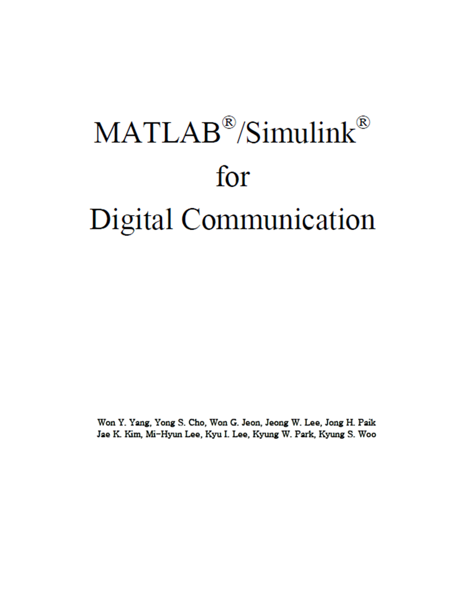

# 2. MATLAB®/Simulink® for Digital Communication[Strongly recommended]

The book's content summary: Rich in MATLAB code.
Chapter 1: Fourier Analysis
Chapter 2: Probability and Random Processes: White Noise and Colored Noise, Linear Filtering of Random Processes and PSD, Amplitude Decay Effects in Multipath Channels.
Chapter 3: Analog Modulation: Amplitude Modulation (AM), DSB (Double Sideband)-AM (Amplitude Modulation), Conventional AM, SSB (Single Sideband)-AM (Amplitude Modulation), Angle Modulation--Frequency/Phase Modulation.
Chapter 4: Digital-to-Analog Converter: Qualification, Unified Qualification, Non-Uniform Qualification, Considering the Relative Error, Pulse Code Modulation (PCM), Differential Pulse Code Modulation (DPCM), Triangular Modulation (DM).
Chapter 5: Baseband Digital Transmission: Receiver (RCVR) and Signal-to-Noise Ratio, RC Filter Type Receiver, Matched Filter Type Receiver, Signal Correlator, Signal and Error Probabilities, Antipodal (Bipolar) Signals, OOK (On-Off Keying)/Single Pole Signaling, Quadrature Signaling, Signal Constellation Diagram, Analog Binary Communication, Multilevel (Amplitude) PAM Signals, Multidimensional Signaling, Dual Quadrature Signaling.
Chapter 6: Band-Limited Channels and Equalizers, Band-Limited Channels, Nyquist Bandwidth, Raise-Cosine Frequency Response, Partial Response Signal - Binary Signal, Equalizers, Zero-Forced Equalizer (ZFE), MMSE Equalizer (MMSEE), Adaptive Equalizer (ADE), Decision Feedback Equalizer (DFE).

Chapter 7: Band-Pass Digital Transmission: Amplitude Modulation - Amplitude Shift Keying (ask), Frequency Modulation - Frequency Shift Keying (fsk), Phase Modulation - Phase Shift Keying (psk), Differential Phase Shift Keying (DPSK), Quadrature Amplitude Modulation (QAM) - PAM/PSK, Comparative Analysis of Different Signals.

Chapter 8: Carrier Recovery and Symbol Synchronization: PLL (Pulse-Code Modulator), Estimating Carrier Phase Using PLL, Carrier Phase Recovery, Recovering Carrier Phase for BPSK Signals using Squared Loop, Costas Loop for PSK Signal Carrier Phase Recovery, Carrier Phase Recovery for QAM Signals, Symbol Synchronization (Timing Recovery), BPSK Signal Timing Recovery at Both Ends, NDA-ELD Sync for SK Signal.

Chapter 9: Information and Coding Source Coding, Huffman Coding, Lempel-Zip-Welch Coding, Source Coding and Channel Coding, Channel Model and Channel Capacity, Channel Coding, Waveform Coding, Linear Block Coding, Cyclic Coding, Convolutional Coding and Viterbi Decoding, TCM (Trapezoidal Coded Modulation), Turbo Coding, Low Density Parity Check (LDPC) Coding, Differential Spatio-Temporal Block Coding (DSTBC), Code Gain.

Chapter 10: PN (Pseudo Noise) sequences in Spread Spectrum Systems, Direct Sequence Spread Spectrum (DS-SS), Frequency Hopping Spread Spectrum (FH-SS).

Chapter 11: OFDM System Distributed Modulators Bandwidth and Bandwidth Efficiency, Carrier Recovery and Symbol Synchronization, Channel Estimation and Equalization, Interleaving and Deinterleaving.

## Images

<!-- PAYMENT_BLOCK -->

## Get this dataset

- Payment link (Stripe): [Buy now](https://buy.stripe.com/3cs8yP7sY87d0vu9AB)
- Payment QR code: 

<!-- /PAYMENT_BLOCK -->
